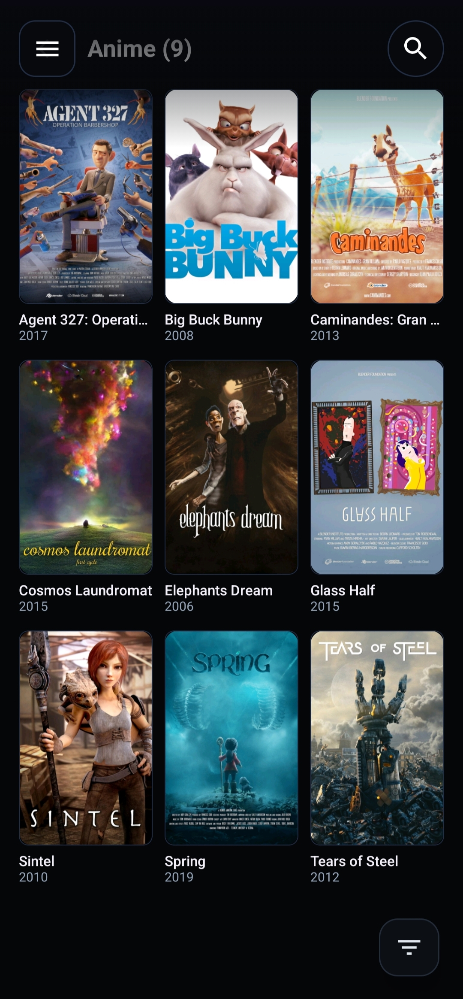
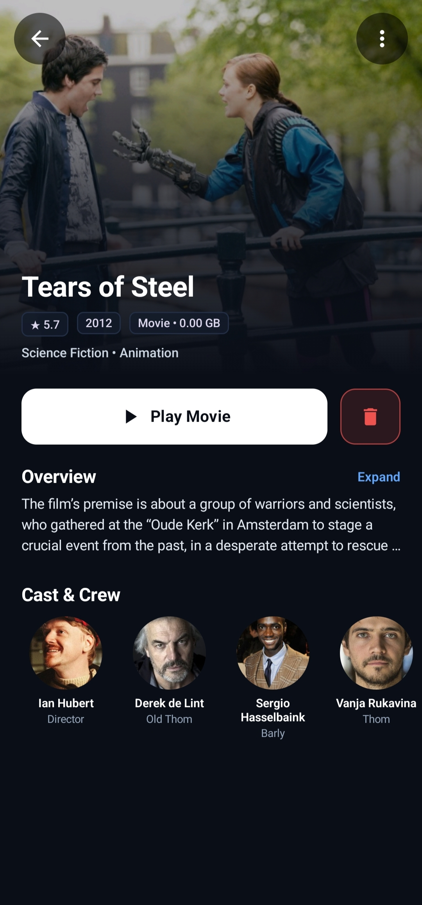
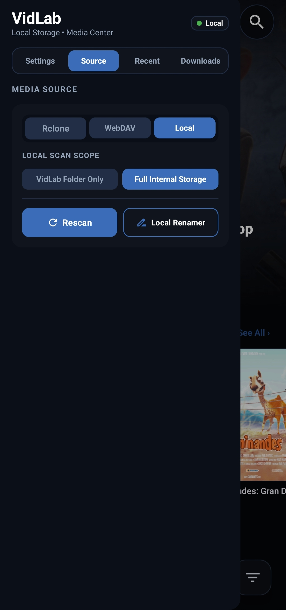

# VidLab

**Video player and media library manager for Android—with built-in WebDAV, embedded Rclone, automatic metadata scraping, and Simkl/Trakt/AniList sync.**

VidLab organizes your local videos and remote cloud/WebDAV libraries into a clean movie and TV show catalog. Stream directly from WebDAV servers or `rclone.conf` remotes, download episodes or full seasons for offline viewing, and play MKV, MP4, and other common formats with embedded or external subtitles.

## Screenshots

<table>
  <tr>
    <td align="center"></td>
    <td align="center"></td>
    <td align="center"></td>
  </tr>
</table>

---

## Core Features

### 1. WebDAV & Embedded Rclone Streaming
- **Direct WebDAV Support**: Connect WebDAV servers (NAS, seedboxes, Nextcloud, OwnCloud, Alist/OpenList) to browse and stream movies and TV series with automatic posters and metadata.
- **Built-in Rclone Engine**: Import your `rclone.conf` directly into VidLab to stream from rclone-supported cloud drives and encrypted (`crypt`) remotes via a local loopback bridge (`127.0.0.1`), with no external apps required. *(Note: Google Drive and other cloud remotes work by importing your existing `rclone.conf` rather than one-click Google OAuth login.)*
- **Offline Downloads**: Download individual episodes, full seasons, unwatched episodes, or entire series from WebDAV and Rclone sources to `Downloads/VidLab` for offline playback.

### 2. Local Video Player & Library Scraper
- **Full Storage & Folder Scanning**: Scans internal storage or a dedicated `/VidLab` directory and groups movies and multi-season shows automatically.
- **Automatic Metadata & Artwork**: Fetches posters, backdrops, summaries, ratings, release years, genres, episode thumbnails, and cast/crew profiles.
- **Cast & Crew Filtering**: Tap any actor or director to view all movies and shows in your library featuring them.
- **Missing Episode Detection**: Highlights missing episode numbers within a season.

### 3. Playback & Watch Sync
- **Media3 (ExoPlayer) + FFmpeg**: Plays MKV, MP4, AVI, MOV, and other formats with hardware/software decoding, touch gestures for brightness/volume/seeking, intro/outro skipping, external subtitle loading, and automatic English audio/subtitle track selection.
- **Progress Tracking & Sync**: Tracks local resume positions with swipe-to-mark-watched gestures and syncs watch history with **Simkl**, **Trakt.tv**, and **AniList**.

---

## Getting Started

1. Download the latest APK from **[Releases](https://github.com/lolzz11/VidLab/releases)** and install it on Android.
2. **Local Library**: Grant storage permission when prompted to scan and play your local videos.
3. **WebDAV / Rclone**: Open the side drawer (`Source`), select **WebDAV** or **Rclone**, configure your server or import `rclone.conf`, and browse your remote files.

---

## Tech Stack

- **UI & Architecture**: Kotlin, Jetpack Compose, Material 3, Coil
- **Playback Engine**: AndroidX Media3 (ExoPlayer) + FFmpeg extension
- **Cloud & Sync**: Embedded `rclone` (`librclone.so`) loopback WebDAV server, Simkl / Trakt / AniList APIs

---

## License

VidLab is free software licensed under the **GNU General Public License v3.0 (GPL-3.0)** — see the [LICENSE](LICENSE) file for details.

---

## Disclaimers & Third-Party Attributions

### Content Disclaimer (Bring Your Own Media)
VidLab is strictly a **local media player and cloud storage client**. VidLab does **not** host, provide, index, scrape, or distribute any movies, TV shows, anime, or copyrighted media files. Users are solely responsible for ensuring they have the legal right to access and stream any content stored on their devices, WebDAV servers, or Rclone remotes.

### API & Open-Source Notices
- **TMDB:** This product uses the TMDB API but is not endorsed or certified by TMDB.
- **Trakt:** VidLab uses Trakt but is not endorsed or certified by Trakt.
- **Metadata & Sync:** Additional metadata, intro markers, and watch-history sync powered by **Simkl**, **AniList**, **AniSkip**, and **TheIntroDB**.
- **FFmpeg & Rclone:** VidLab uses libraries from the **FFmpeg** project under the **LGPLv2.1+** and embeds **Rclone** under the **MIT License**. See [THIRD_PARTY_NOTICES.md](THIRD_PARTY_NOTICES.md) for full license details.
